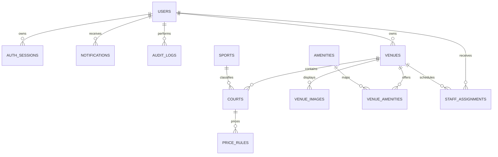
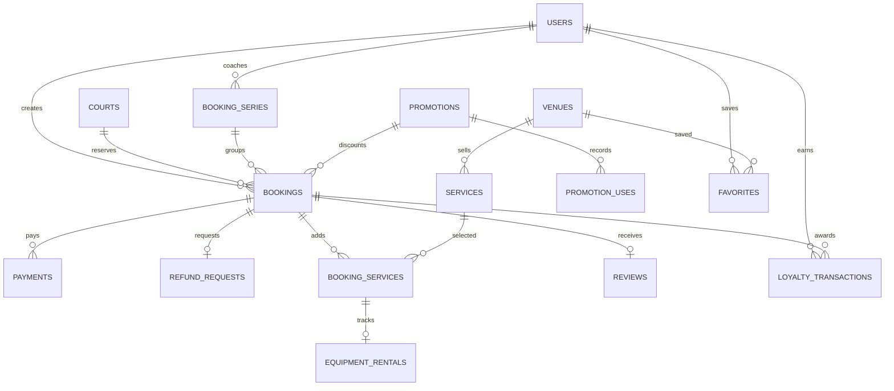
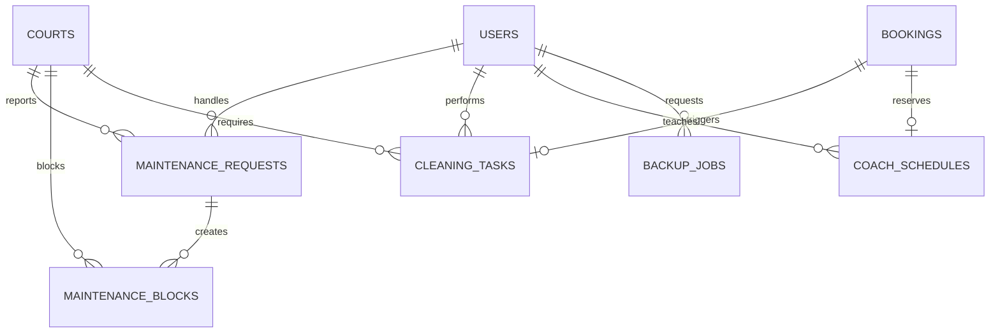

# ERD MySQL của N01SPORT

Schema v3 gồm 43 bảng nghiệp vụ/hệ thống (32 bảng nền + 11 bảng bổ sung) và bảng kỹ thuật `schema_migrations`. `full-schema.sql` tổng hợp bảng nền và migration; công cụ `db:migrate` tự quản lý bảng version.

## Tài khoản và danh mục sân

## Booking, thanh toán và quyền lợi

## Vận hành sân

## Danh sách bảng

| Nhóm | Bảng |
|---|---|
| Tài khoản | `users`, `auth_sessions`, `password_reset_tokens`, `notifications`, `audit_logs` |
| Sân | `sports`, `venues`, `venue_images`, `amenities`, `venue_amenities`, `courts`, `price_rules` |
| Kinh doanh | `promotions`, `booking_series`, `bookings`, `payments`, `refund_requests`, `services`, `booking_services`, `equipment_rentals`, `promotion_uses` |
| Khách hàng | `reviews`, `favorites`, `loyalty_rules`, `loyalty_transactions`, `coach_schedules` |
| Vận hành | `staff_assignments`, `maintenance_requests`, `maintenance_blocks`, `cleaning_tasks` |
| Hệ thống | `site_settings`, `backup_jobs` |

## Quan hệ bổ sung của v3

| Bảng | Quan hệ và ràng buộc |
|---|---|
| `venue_payment_settings` | Một cấu hình ngân hàng cho mỗi cơ sở; `venue_id` vừa là PK vừa là FK đến `venues` |
| `payment_events` | FK nullable đến `bookings`; UNIQUE `(provider,event_id)` chống xử lý lại webhook |
| `service_orders` | FK đến `bookings`, `users`, `venues`; mã đơn UNIQUE, tiền dịch vụ tách khỏi tiền sân |
| `service_order_items` | FK đến `service_orders`, `services`; UNIQUE `(order_id,service_id)`; lưu số lượng giao/trả/mất |
| `support_tickets` | FK đến người gửi `users` và cơ sở `venues` (có thể null cho hỗ trợ hệ thống) |
| `support_replies` | Nhiều phản hồi cho một ticket; FK đến `support_tickets` và người trả lời `users` |
| `rewards` | FK đến chủ sân `users`; điểm đổi và giá trị giảm phải lớn hơn 0 |
| `reward_redemptions` | FK đến `users`, `rewards`, `promotions`; mỗi lượt đổi tạo một mã khuyến mãi riêng UNIQUE |
| `email_outbox` | Hàng đợi email có trạng thái và số lần thử; không lưu mật khẩu SMTP |
| `system_errors` | Mã lỗi và đường dẫn; không lưu stack trace hoặc nội dung request nhạy cảm |
| `auth_attempts` | PK là SHA-256 email chuẩn hóa; dùng giới hạn đăng nhập thất bại theo thời gian |
| `schema_migrations` | PK là tên migration đã áp dụng; do `db:migrate` tạo, không thuộc 43 bảng trên |

`booking_services` và `equipment_rentals` là cấu trúc v2 được giữ để tránh mất dữ liệu cũ. Luồng bán/thuê v3 ghi vào `service_orders` và `service_order_items`; dữ liệu cũ không được tự chuyển thành đơn mới.

Khoảng thời gian không thể chống chồng chỉ bằng UNIQUE: API khóa hàng `courts` trước khi kiểm tra và tạo booking, khóa booking khi thêm dịch vụ/hủy và khóa hàng tồn kho khi xuất/nhận lại. Các thao tác nghiệp vụ phải đi qua API, không chèn trực tiếp vào MySQL. Thời gian nghiệp vụ theo múi giờ Việt Nam (+07:00); tiền lưu dạng số nguyên VND.

Các bảng nền và nghiệp vụ dùng InnoDB, `utf8mb4`, khóa ngoại và chỉ mục theo truy vấn. Bảng version do công cụ migration tạo với mặc định của MySQL. Không xóa dữ liệu giao dịch đã phát sinh; dùng trạng thái khóa/ngừng hoạt động.
