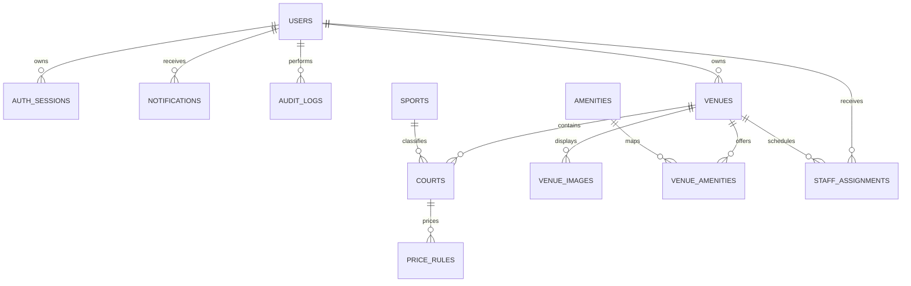
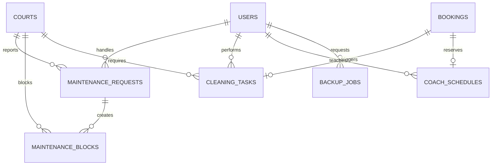

# ERD MySQL của N01SPORT

Schema gồm 32 bảng, chia thành ba phân hệ để sơ đồ dễ đọc.

## Tài khoản và danh mục sân

## Booking, thanh toán và quyền lợi

## Vận hành sân

## Danh sách bảng

| Nhóm | Bảng |
|---|---|
| Tài khoản | `users`, `auth_sessions`, `password_reset_tokens`, `notifications`, `audit_logs` |
| Sân | `sports`, `venues`, `venue_images`, `amenities`, `venue_amenities`, `courts`, `price_rules` |
| Kinh doanh | `promotions`, `booking_series`, `bookings`, `payments`, `refund_requests`, `services`, `booking_services`, `equipment_rentals`, `promotion_uses` |
| Khách hàng | `reviews`, `favorites`, `loyalty_rules`, `loyalty_transactions`, `coach_schedules` |
| Vận hành | `staff_assignments`, `maintenance_requests`, `maintenance_blocks`, `cleaning_tasks` |
| Hệ thống | `site_settings`, `backup_jobs` |

Tất cả bảng dùng InnoDB, `utf8mb4`, khóa ngoại có quy tắc xóa rõ ràng và chỉ mục theo truy vấn thường dùng.

Booking đặt tại quầy có `user_id = NULL`, lưu tên và số điện thoại ở `guest_name`, `guest_phone`. Người lễ tân thao tác được ghi ở `audit_logs.actor_id`; đơn được xác nhận ngay và trạng thái thu tiền được lưu riêng trong `payments`.
