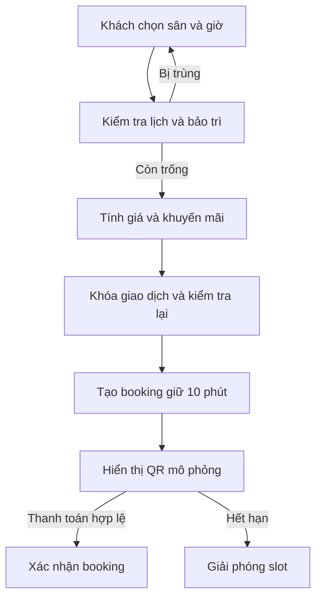
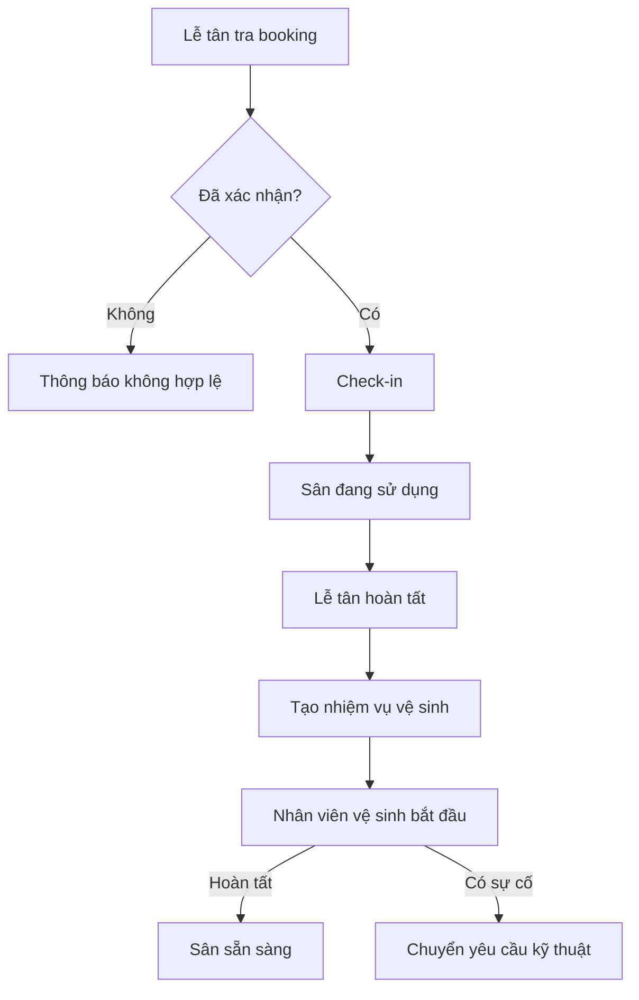
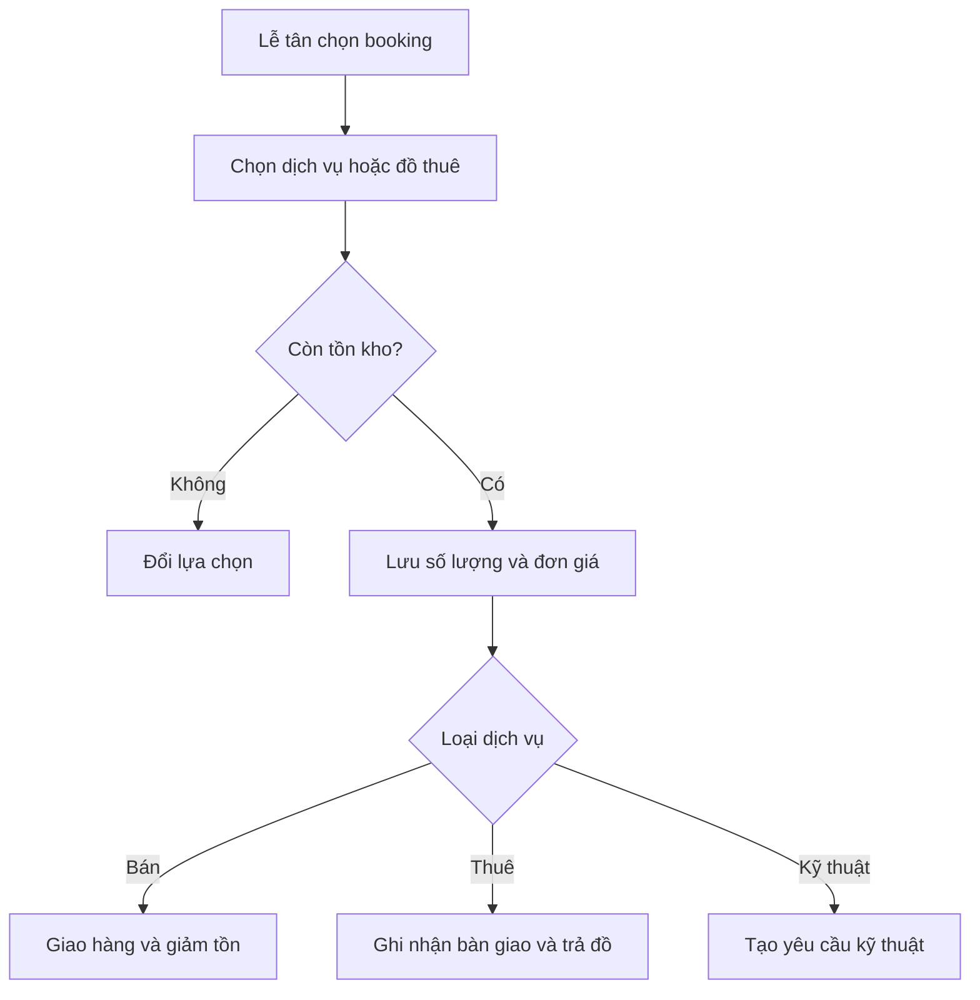
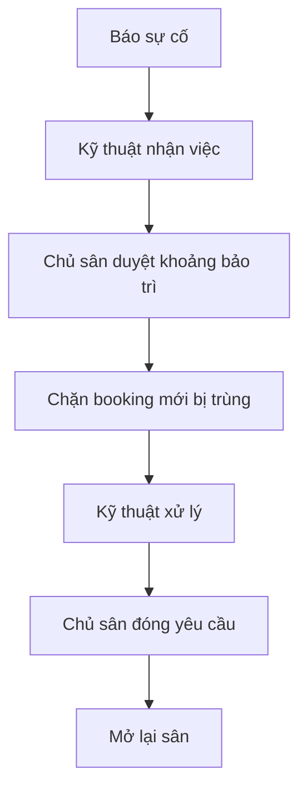
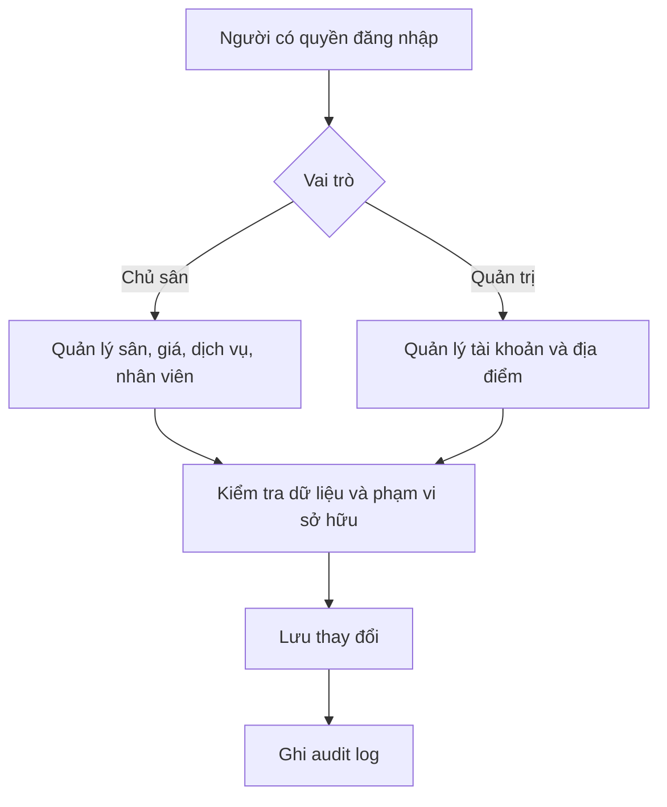
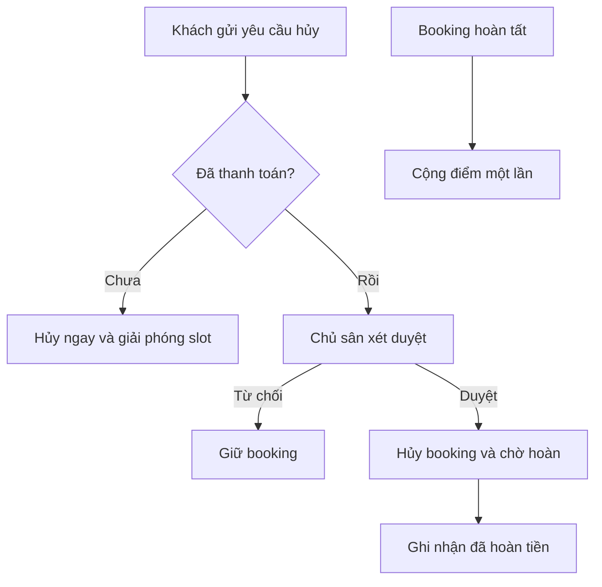

# Workflow hệ thống N01SPORT

## WF01 và WF02: đặt sân, giữ chỗ và thanh toán

## Lễ tân đặt sân tại quầy

Lễ tân chọn **Đặt sân cho khách**, chọn sân thuộc cơ sở được phân công, nhập tên/số điện thoại và chọn ngày/khung giờ. Backend khóa sân và phân công, kiểm tra giờ mở cửa, trùng lịch và bảo trì, tính giá theo khung giờ rồi tạo booking `confirmed` không có thời hạn giữ chỗ. Khách không cần tài khoản. Có thể ghi nhận đã nhận tiền mặt/chuyển khoản khi tạo, hoặc để chưa thu và ghi nhận sau ở lịch lễ tân. Mỗi lần thu tiền được khóa giao dịch để ngăn ghi nhận lặp. Đơn có trong lịch theo ngày và báo cáo chủ sân; người thao tác được ghi vào audit log.

## WF03 và WF07: check-in, hoàn tất và vệ sinh

## WF04 và WF05: dịch vụ phát sinh

## WF06: bảo trì và chặn lịch

## WF09, WF10 và WF14: quản lý dữ liệu

## WF12 và WF13: hủy, hoàn tiền và tích điểm

Workflow HLV đặt định kỳ được hỗ trợ ở mô hình `booking_series`, `bookings` và `coach_schedules`. Bản demo chưa mở form tạo chuỗi để tránh làm luồng đặt sân cơ bản quá phức tạp.
